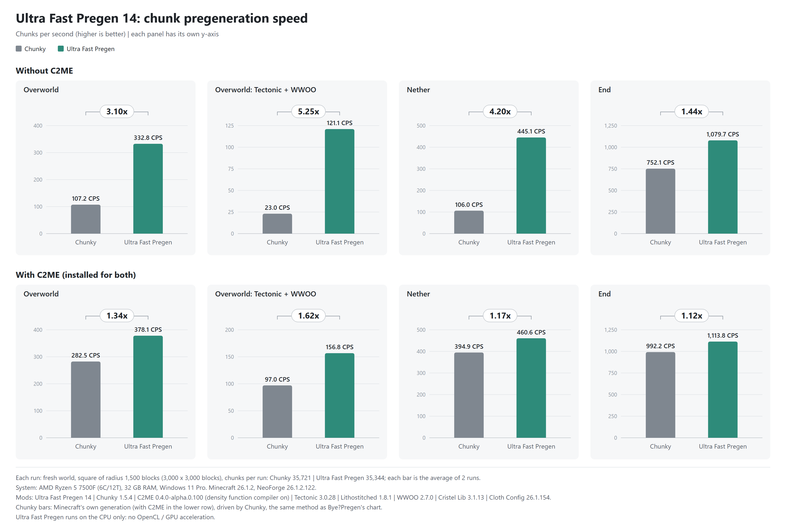

# Ultra Fast Pregen

A world pre-generation mod for Minecraft servers and singleplayer, also as a plugin for Bukkit servers (CraftBukkit,
Spigot, Paper, Folia) and Sponge. It generates a square area one batch at a time
**in RAM, with every CPU core in every stage**, then writes each batch to the region files in one go.
The blocks, biomes and light are those of Minecraft's own generation steps (checked block for block by its test suite);
what differs from a world the server generates by itself is listed under [Limitations](#limitations).

Mods for Fabric, NeoForge and Forge, every Minecraft version from 1.20 to 26.3. Each file is named
`ultrafastpregen-<name below>-16.jar`:

| Minecraft | Java | Fabric | NeoForge | Forge |
|---|---|---|---|---|
| 1.20 to 1.20.4 | 17+ | `fabric-1.20.x` | 1.20.1: `neoforge-1.20.1`; 1.20.2 to 1.20.4: `neoforge-1.20.2-1.20.4` | `forge-1.20-1.20.4` |
| 1.20.5, 1.20.6 | 21+ | `fabric-1.20.x` | `neoforge-1.20.5-1.20.6` | 1.20.6: `forge-1.20.6` |
| 1.21, 1.21.1 | 21+ | `fabric-1.21-1.21.1` | `neoforge-1.21-1.21.1` | `forge-1.21-1.21.1` |
| 1.21.2 to 1.21.4 | 21+ | `fabric-1.21.2-1.21.4` | `neoforge-1.21.2-1.21.4` | 1.21.3, 1.21.4: `forge-1.21.3-1.21.4` |
| 1.21.5 | 21+ | `fabric-1.21.5` | `neoforge-1.21.5` | `forge-1.21.5` |
| 1.21.6 to 1.21.8 | 21+ | `fabric-1.21.6-1.21.8` | `neoforge-1.21.6-1.21.8` | `forge-1.21.6-1.21.8` |
| 1.21.9, 1.21.10 | 21+ | `fabric-1.21.9-1.21.10` | `neoforge-1.21.9-1.21.10` | `forge-1.21.9-1.21.10` |
| 1.21.11 | 21+ | `fabric-1.21.11` | `neoforge-1.21.11` | `forge-1.21.11` |
| 26.1 to 26.2 | 25+ | `fabric-26.1-26.2` | 26.1.2, 26.2: `neoforge-26.1.2-26.2` | `forge-26.1-26.2` |
| 26.3 | 25+ | `fabric-26.3` | `neoforge-26.3` | `forge-26.3` |

Fabric needs no Fabric API. There is no Forge for Minecraft 1.20.5 and 1.21.2, and NeoForge has only betas for 26.1
and 26.1.1. NeoForge for 1.20.1 is the fork of Forge that takes Forge's jar.

Plugins, still at round 15.1:

| Server | Minecraft | Java | File |
|---|---|---|---|
| Bukkit plugin: CraftBukkit, Spigot, Paper, Folia | 26.2 | 25+ | `ultrafastpregen-bukkit-26.2-15.1.jar` ([ports/bukkit-26.2](ports/bukkit-26.2/README.md)) |
| Sponge (SpongeVanilla, API 20) | 26.2 | 25+ | `ultrafastpregen-sponge-26.2-15.1.jar` ([ports/sponge-26.2](ports/sponge-26.2/README.md)) |

**Download:** the mods on [CurseForge](https://www.curseforge.com/minecraft/mc-mods/ultra-fast-pregen), the Bukkit plugin
on [CurseForge](https://www.curseforge.com/minecraft/bukkit-plugins/ultra-fast-pregen-bukkit).

`16` is the update round, the same for every mod build ([changelog](CHANGELOG.md#16)). Install it on the server only:
players do not need it (it has no packets of its own). In singleplayer it runs in the integrated server. The Bukkit
plugin goes in the server's `plugins` folder, the Sponge build in its `mods` folder. The Bukkit plugin cannot change
Minecraft's code as the mods do, so it has no fast terrain path and is slower; see its page for how it differs.

**Worlds pregenerated with 15.1 or older on Minecraft 1.20 to 1.21.1:** those versions saved chests, barrels and
pots without their loot and spawners without their mob. 16 fixes it for what it generates; what an older version
generated stays empty until the area is generated again ([changelog](CHANGELOG.md#fixed)). The builds for
Minecraft 26.x and the plugins were never affected.

**One mod, three parts.** Ultra Fast Pregen Link (pregen in a separate world of this server or on other servers) and
Ultra Fast Pregen Manager (a web page to run pregens) are parts of this jar since 16. Both start off: see
[The mod's parts](#the-mods-parts).

## Speed

Measured with version 14 and the [benchmark tool](benchmark/README.md) on an **AMD Ryzen 5 7500F (6 cores, 12 threads)**,
32 GB RAM, Windows 11, NeoForge 26.1.2: a fresh world (seed 42), a square of radius 1,500 blocks (about 35,000 chunks),
average of 2 runs. "Vanilla" is Minecraft's own generation driven by Chunky 1.5.4.



| World | Vanilla (Chunky) | Ultra Fast Pregen | Speed-up |
|---|---|---|---|
| Overworld | 107.2 chunks/s | **332.8 chunks/s** | 3.10× |
| Overworld, Tectonic + WWOO | 23.0 | **121.1** | 5.25× |
| Overworld + C2ME | 282.5 | **378.1** | 1.34× |
| Overworld, Tectonic + WWOO + C2ME | 97.0 | **156.8** | 1.62× |
| Nether | 106.0 | **445.1** | 4.20× |
| Nether + C2ME | 394.9 | **460.6** | 1.17× |
| End | 752.1 | **1,079.7** | 1.44× |
| End + C2ME | 992.2 | **1,113.8** | 1.12× |

**Version 15 is faster than these numbers from 14:** whole Overworld runs without other mods are **21% faster on
NeoForge 26.1.2** and **17% faster on Fabric 26.2** (the surface rule shortcuts +5% / +7%, then the other new steps
+15% / +9%; i9-11900T, 16 threads, 2,000 × 2,000 blocks; see [Faster](CHANGELOG.md#faster-1)). **Version 16 is
faster again:** a whole Overworld run without other mods is **40% faster than 15.1 on NeoForge 26.1.2** (248 → 347
chunks/s on an Intel Xeon E5-2670 v2 with 20 threads, 4,000 × 4,000 blocks, three runs each), and about as much on
1.21.1 and 1.20.1 ([all numbers](COMPATIBILITY.md#speed-against-151)). The table and chart have not been measured
again with 15 or 16.

Ultra Fast Pregen runs on the CPU only (no OpenCL / GPU). The same worlds on Bye?Pregen's published chart
(Ryzen 9 9950X3D, 16 cores / 32 threads, NeoForge 26.1.2, also Chunky as vanilla): vanilla 201.9 → Bye?Pregen 304.1 chunks/s (1.51×),
Tectonic + WWOO 27.9 → 60.2 (2.16×), C2ME 1,173.2 → 1,467.6 (1.25×), Tectonic + WWOO + C2ME 301.7 → 531.1 (1.76×).
Different machines: compare the speed-ups, not the absolute numbers.

**Modpacks** (Intel Xeon E5-2670 v2, 20 threads, version 15 against 14.1): All the Mods 10 59.6 → 60.0 chunks/s (+1%),
All the Mods 9 51.5 → 60.1 (+17%), Prominence II 52.6 → 51.5 (−2%), one run each; a run's speed varies by up to about
10%. Other mods in these packs change most of the code that the new fast steps of 15 stand in for, so those steps turn
themselves off ([details](COMPATIBILITY.md#modpacks)).

## Quick start

```
/pregen center 0 0
/pregen start 4        # a 4000 x 4000 block square around the center
/pregen status
```

Or any radius, as a square or a circle:

```
/pregen radius 2500
/pregen shape circle
/pregen start          # the chunks within 2500 blocks of the center
```

Operators (level 2) see the progress, speed and ETA on a boss bar. `/pregen stop` stops after the current batch;
`/pregen resume` continues the last run of the selected world. When the server stops during a run, it first waits for the
batch being saved (up to 20 s). A run cut short this way, or by a crash, continues by itself once the server has started
again (`resume_after_restart`).

## Commands (operator level 2; in singleplayer the world's owner, cheats or not)

| Command | What it does |
|---|---|
| `/pregen start` | Generates the area chosen with `/pregen radius` (or `/pregen worldborder`) around the center |
| `/pregen start <world_k> [profile]` | Generates an area `world_k × 1000` blocks across around the center, in the chosen shape (`profile` records a JFR profile in the server folder) |
| `/pregen radius <blocks>` | The radius of the next `/pregen start` (1..50,000) |
| `/pregen shape <square\|circle>` | The shape: a square, or a circle (every chunk whose center lies within the radius) |
| `/pregen worldborder` | Center and radius from the selected world's border (a square) |
| `/pregen spawn` | The world spawn as the center |
| `/pregen resume` | Continues the last run of the selected world with its size and center from the save file |
| `/pregen reset` | Forgets which chunks Ultra Fast Pregen generated in the selected world |
| `/pregen stop` | Stops after the current batch |
| `/pregen status` | Progress, speed, ETA and RAM |
| `/pregen world [dimension]` | Selects the world, e.g. `minecraft:the_nether` (default: the sender's world; the console means the overworld) |
| `/pregen center [x z]` | The center (`~ ~` works; default `0 0`) |
| `/pregen set batch_size <512..10000>` | Batch size, saved in the config file for the next `start` |
| `/pregen set threads <max\|1..128>` | Number of workers |
| `/pregen set skip_existing_chunks <true\|false>` | Keep chunks that already exist, or regenerate them |
| `/pregen set resume_after_restart <true\|false>` | Continue a run cut short by a server stop or crash once the server has started |
| `/pregen set depth <full\|features\|terrain>` | How far a run generates each chunk (see the settings) |
| `/pregen ufp\|ufplink\|ufpmanager [on\|off]` | Shows a part of the mod, or turns it on or off (operator level 4; see [The mod's parts](#the-mods-parts)) |
| `/pregen set` | Shows the values |

On Bukkit servers, `/pregen` and the boss bar need the permission `ultrafastpregen.command` (operators have it by default).
`world`, `center`, `radius` and `shape` last until the server restarts; a running job keeps its own.
The console shows `Progress / Speed / ETA` every 3 seconds and, after each batch, a `Step times` line with the time of every stage.

## Configuration: `config/ultrafastpregen.conf`

Read again on every `start`. Missing keys are added automatically. The Bukkit plugin keeps it in
`plugins/UltraFastPregen/ultrafastpregen.conf`.

| Key | Default | Meaning |
|---|---|---|
| `batch_size` | `1000` | Batch size in blocks (512..10000); larger batches are slightly faster but RAM grows with the square |
| `threads` | `max` | Workers (`max` = every core the JVM sees) or 1..128 |
| `skip_existing_chunks` | `true` | Keep chunks that already exist and generate only missing ones; `false` regenerates and overwrites the whole area |
| `parallel_steps` | `true` | Structures, carvers and features on all threads; set `false` if a worldgen mod crashes when they run in parallel |
| `parallel_features` | `auto` | `auto` runs features on all threads, except when another mod keeps state in feature placement (BCLib and the mods built on it): then one chunk at a time, so that they land where the server would put them. `always` runs them on all threads there too: faster, but in such a pack the world is **not** the one the server would generate (in Prominence II many features of other mods came out far rarer or in other places; [measured](COMPATIBILITY.md#in-the-modpacks-with-the-packs-own-game)) |
| `release_memory_each_batch` | `true` | Runs a GC after each batch to give RAM back (pauses about 0.1–0.2 s); `false` if players notice it |
| `terrain_pipeline` | `auto` | `auto` uses the fast path with Minecraft's noise generator; `vanilla` always uses Minecraft's own steps; `fused` forces the fast path |
| `resume_after_restart` | `true` | Continue a run cut short by a server stop or crash (not by `/pregen stop`) once the server has started; after 3 restarts in a row without a saved batch it stops trying |
| `depth` | `full` | How far a run generates each chunk. `full`: terrain, features, light and mobs, so chunks load at once when players come. `features`: terrain and features; Minecraft adds light and mobs when a chunk is first loaded. `terrain`: terrain and caves only, the fastest, with the most work left for later. A later `full` run over the same area completes the chunks |
| `ufp`, `ufplink`, `ufpmanager` | `on`, `off`, `off` | The parts of the mod, each on or off; `/pregen ufp\|ufplink\|ufpmanager on\|off` sets them without a restart |

**Not enough RAM:** when the free heap cannot hold `batch_size`, the batch shrinks by itself (down to 256) and the chat says so,
instead of running out of memory. With room for two batches (about 3.8 GB for batch 1000), each batch is lit and saved while the next one generates.

## The mod's parts

| Part | What it is | Switch | Starts |
|---|---|---|---|
| Ultra Fast Pregen | The pregenerator: `/pregen` | `/pregen ufp on\|off` | on |
| Link | Pregen in a separate world of this server, or shared out to other servers that send their chunks back: `/ufplink` | `/pregen ufplink on\|off` | off |
| Manager | A web page to start, watch and stop pregens, with a map of the world: `/ufpmanager` | `/pregen ufpmanager on\|off` | off |

- The switches work at once and are kept in the settings file. The server console says at every start which parts are
  off and how to turn them on. With `ufp` off nothing of the mod runs, and Link and Manager wait for it.
- **Link, host and clients:** `/ufplink set host [address]` makes this server the host and prints an invite;
  `/ufplink set client <invite>` on another server joins it; `/ufplink set none` leaves. The connection is encrypted.
  Host and clients need the same version of the mod.
- **Manager, the Health tab:** what could go wrong with a run, each line with pass, warning or problem and what to
  do about it. Before a run, for the area chosen on the Pregen tab: disk space against the size of the area, the
  server's memory, the world border, how many chunks exist already (and whether the settings would replace them),
  settings that change the world. During a run: no progress for five minutes, the speed of the last ten minutes at
  under half the run's, memory that stays full, a disk that will not last to the end. For a Link host: a run with no
  machine, a machine that has gone silent or is much slower than the others, chunks that were not taken, machines
  that were refused and why. It only reads; `/api/health` gives the same as JSON to whoever has the page's token.
- Link and Manager were mods of their own up to 15.1 (`ufplink`, `ufpmanager`). Remove those jars: while one is
  installed, the built-in part of the same name stays off and says so.

## Existing chunks (`skip_existing_chunks=true`)

- At start it reads each region file's header once and only the `Status` of existing chunks (4,096 chunks in about 0.1 s).
- **Kept:** fully generated chunks on disk and chunks the server holds.
- **Generated and overwritten:** chunks the server left part-generated, so the area really ends up complete.
- **Seamless edges:** kept chunks are not regenerated; their real blocks are read from disk, so features of new chunks reach into them
  as in vanilla (trees are not cut along the line where the old world meets the pregenerated part).

## Save file and resuming

`<world>/data/ultrafastpregen.dat` (other dimensions in their own folder) records which chunks Ultra Fast Pregen generated,
1 bit per chunk, saved after every batch that reached the disk. `/pregen resume` continues from it.
Stopping and resuming gives the blocks of an uninterrupted run. With `skip_existing_chunks=false`, a new `/pregen start` forgets
what the file has for its area, and `/pregen resume` keeps what that run saved.

## How it works

Each batch is generated in RAM in this order:

1. **Structure starts and references** for the batch and a 9-chunk ring (structures reference up to 8 chunks away).
2. **Biomes, noise and surface** in one fused pass for the batch and a 1-chunk ring.
3. **Carvers (caves).**
4. **Features**, in the 9-phase order Minecraft's dependencies require for chunks that write over each other; other chunks start right away.
5. **Light:** Minecraft's own light engine on the worker threads, one copy for each tile of 8 × 8 chunks, reading the batch
   from RAM. Batches with chunks the server holds, and servers where another mod changes the light engine, are lit with
   Minecraft's INITIALIZE_LIGHT and LIGHT steps on the server's light engine.
6. **Initial mob spawning**, chunk by chunk as in vanilla.
7. **Saving:** encoding on all threads, then one write per region file through the server's IO worker.

Steps 5–7 of a batch run while the next batch runs steps 1–3. Feature placement that crosses a batch edge is carried into
the next batch (or merged back into the saved chunk), so batches give the same blocks as one run (test `BATCH_SEAM_CHECK`).

**Stage 2 is about 1.8× faster than Minecraft with bit-identical results:** 4×8×4 noise cells proven all air or all stone from the
interpolation corners skip per-block work; aquifer and biome lookups are cached per column; surface writes without per-block allocation;
each chunk's surface step reads the biomes around it once and leaves out the surface-rule tests those biomes decide.

## Correctness

The test suite (`runPartialBatchCheck`, `runTerrainBenchmark`) runs on a real server before a release, on each source tree
that carries it (Fabric 1.20.x, Forge 1.20.1, Fabric 1.21.1, NeoForge 1.21.1, NeoForge 26.1.2, Fabric 26.2 and Fabric 26.3);
the jars for the other versions are built from those sources and are compared with a reference world chunk by chunk
([COMPATIBILITY.md](COMPATIBILITY.md#version-16)):

- Terrain, biomes, heightmaps and fluids match Minecraft's own steps block for block (overworld, nether, end and the large biomes,
  amplified, caves and floating islands presets).
- Sky and block light of every block match Minecraft's light engine on the same blocks (1,572,864 blocks, 0 different).
- Block entities hold what generation put into them (a chest's loot table, a spawner's mob): checked by the suite
  since 16 and compared with a world that a server with no mod generated
  ([the test](COMPATIBILITY.md#block-entities-against-a-world-with-no-mod)).
- Batch seams, stopping and resuming, and joining an existing area give the blocks of one uninterrupted run.
- A batch that fails on the fast paths is generated again Minecraft's way with the same blocks (`SAFE_MODE_RETRY_CHECK`),
  and one whose lighting or saving fails is generated again from what is saved (`TAIL_FAILURE_RETRY_CHECK`).

## Compatibility with other mods

- **Automatic mixin check:** if another mod changes a method a fast path replaces, that fast path turns itself off and the start-up log says
  which mod. Mixins that only add accessors or touch other methods no longer force the slower path (round 14), so big modpacks keep the fast path.
- **Safety net (round 14):** if a batch still fails on the fast paths (another mod's code that does not expect them), the batch is generated
  again the way Minecraft does (per-status terrain, one chunk at a time) and the rest of the run continues that way. The log names the mods involved.
- **C2ME:** supported on every build, including its own chunk storage, on the fast terrain path, and since 15.1 with
  each batch lit on the worker threads ([changelog](CHANGELOG.md#151)). On 1.20.1 the cell-skipping fill works with C2ME too. On 1.21.1 and 26.x it steps aside while C2ME's density function compiler is on (C2ME's default):
  on 26.x that is the faster setting; on 1.21.1, setting `useDensityFunctionCompiler = false` under
  `[vanillaWorldGenOptimizations]` in `config/c2me.toml` is faster still.
- **Distant Horizons / Voxy (26.x builds):** saved chunks are sent to their LoD databases (Voxy only in singleplayer, as it is client-side).
- **Datapacks, biome and structure modifiers:** work, since every step reads the world's registries.
- **Tested together with** popular performance, LoD and worldgen mods on all six builds (C2ME, Lithium / Canary, Noisium,
  FerriteCore, ModernFix, Starlight / ScalableLux, Distant Horizons, Voxy, Terralith, Biomes O' Plenty, YUNG's Better Caves,
  Alex's Caves), in the Overworld, Nether and End with every saved chunk checked, and with the modpacks All the Mods 9,
  All the Mods 10 and Prominence II. The mods, versions and results are in [COMPATIBILITY.md](COMPATIBILITY.md).
  With Lithium or Canary and Noisium together, or with Alex's Caves, the start-up log shows Minecraft's per-status
  terrain path: those mods change steps the fast path would skip, so it steps aside by itself.
- **Not supported yet by the mods: Moonrise.** It replaces Minecraft's chunk system (chunk storage, chunk holders and the
  light engine), which this mod generates and saves through; `/pregen start` says so and does nothing. Paper and Folia,
  which have Moonrise built in, are supported by the Bukkit plugin, which saves through Paper's chunk storage.

## For mod and plugin developers

Other mods and plugins (Bukkit, Spigot, Paper, Folia, Sponge) can start and stop runs, follow them, receive every
chunk they save, and declare how their own world generation changes interact with the fast paths: see [API.md](API.md).

## Limitations

- The Moonrise mod is not supported yet by the mods (see Compatibility); Paper and Folia are, by the Bukkit plugin.
- **A chunk no server has loaded yet** holds what Minecraft removes or settles when a chunk first ticks, as a chunk
  Minecraft generated and never ticked does: brown and red mushrooms standing in daylight (about 25 times as many as
  will stay), water and lava that have not flowed yet. Map and LoD mods that read pregenerated chunks see that state
  ([measured](COMPATIBILITY.md#mushrooms-and-what-grows-beside-them)).
- **The edge of an area made by version 15.1 or older.** Since 16 the row of chunks around the area gets its features
  too and is left for the server to finish, as Minecraft leaves the neighbors of its own chunks. An older area lacks,
  in its outermost chunks, what the chunks outside place inward (seagrass, a disk of sand or clay, part of a geode,
  leaves). Running the same `/pregen start` again with 16 adds it in seconds, without generating any chunk of the
  area again, wherever the server has not yet generated beyond the area itself
  ([measured](COMPATIBILITY.md#with-the-corrections-of-the-edge)).
- Single blocks differ from a server's own world of the same seed where features of neighboring chunks overlap (stone
  blobs, ores, seagrass), as they do between two runs of a server with no mod. On one of three servers tested, the stone
  kind placed later won such overlaps more often in the pregenerated world (about 1% more andesite); why is not known.
- It uses every core: with players online, lower `threads` by 1–2.
- Chunks the server is holding (players nearby) and chunks of old Minecraft versions not yet upgraded do not receive features that reach into them.

## Building and testing

```powershell
.\gradlew.bat build                                  # Fabric 1.20 to 1.20.6 (root)
.\gradlew.bat -p ports/neoforge-26.1.2 build         # other builds
.\gradlew.bat runTerrainBenchmark
.\gradlew.bat runPartialBatchCheck -PcheckHeap=8G    # set a new level-name in build/partial-batch-check/server.properties first
```

The benchmark tool used for the speed section is in [benchmark/](benchmark/README.md).

## License

LGPL-3.0
